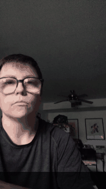
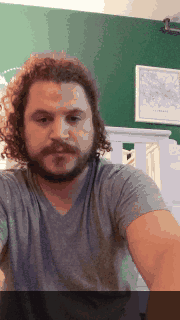
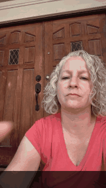
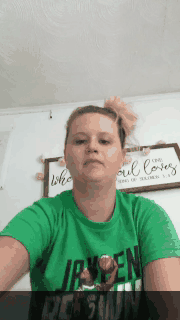
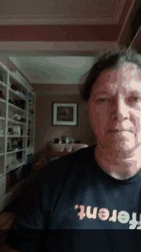
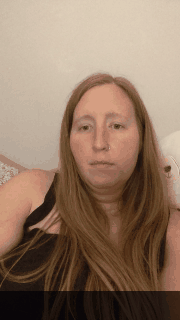
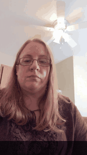
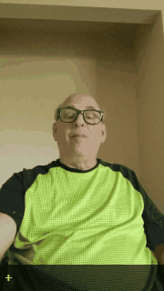

# FSboard Alignment

Aligns and filters [FSboard](https://www.kaggle.com/datasets/googleai/fsboard), the ASL fingerspelling dataset.
For each of its 150,754 clips, a full run gives:

- `alignments.json`: when each character of the label is signed.
- `suspects.json`: the clips whose label may not match the signing, in three tiers, to filter out.

**Both files are attached to the [latest release](https://github.com/sign/fsboard-alignment/releases/latest)** as
`.json.gz`, so you can download them without running anything. Their format is described under [Output](#output).

## Example alignments

| subset: DAUN | subset: DAUN | subset: DMK | subset: DMK |
|---|---|---|---|
|  |  |  |  |
| `8680 gifford ferry road` | `3197 gunlock lake` | `goldilocks and the three bears` | `my bike has a flat tire` |

The letters are drawn as the alignment says they are signed.

## Suspicious annotations

16,237 clips (10.8%) are flagged in three tiers, worst first. Each has a `tier`, a `level` and its `reasons`:

| Tier | Level | Clips | Rule |
|---|---|---|---|
| `clear` | 3 | 2,950 (2.0%) | part of the phrase is signed twice, or the model cannot read the label |
| `likely` | 2 | 1,566 (1.0%) | `missing_word:<word>`: one of the three readings skips a whole label word |
| `unlikely` | 1 | 11,721 (7.8%) | `same_error:<label>><read>`: all three readings, also the one trained on the label, make the same error |

A slip in one reading (`sumrises` for `sun rises`) is not flagged; spaces and doubled letters are ignored.

Reasons in the `clear` tier:

| Reason | Clips | What happened |
|---|---|---|
| `false_start:<part>` | 514 | starts the phrase, stops, starts again from the beginning |
| `false_end:<part>` | 23 | finishes, then signs the ending again |
| `repeat:<part>` | 220 | goes back inside the phrase, usually to the start of a word |
| `misread` | 2,212 | the model cannot read the label in the clip |

| `false_start:file all compl` | `false_end:bowen` | `repeat: marg` | `misread` |
|---|---|---|---|
|  |  |  |  |
| label `file all complaints in writing`, read as `file all complfile all complaints in writing` | label `7640 doctor bowen`, read as `7640 doctor bowmenbowen` | label `534315 margaret maclin`, read as `534-315 marg/margaretmaclm` | label `+84-090-1060-89`, read as `4 a`: a one-second clip with no signing |

Where a part is signed twice, the alignment has to pick one of the two attempts for each character.

## How it works

1. **Features** (`fsboard_alignment.features`): the CNN of
   [MiCT-RANet18-FSBoard](https://github.com/fmahoudeau/MiCT-RANet-ASL-FingerSpelling), frozen, runs once over each
   256x256 letterbox video and is pooled to one 1,536-number feature per 66 ms.
2. **Training** (`fsboard_alignment.train`): a small transformer CTC head (5.5M parameters) over those features,
   predicting characters. It trains on every clip, test split included: the goal is the alignment of this data, not
   a model for other data.
3. **Inference** (`fsboard_alignment.align`): the head's reading of each clip, and the forced alignment of its
   label.
4. **Suspects** (`fsboard_alignment.suspects`): four more heads each train on half the clips and read the other
   half. Two see the whole clip; two see about a second of context, so they cannot learn to skip a part that is
   signed twice. A clip is flagged when a reading from a head that never saw it contains a repeat, or misses most of
   the label.

We use video features, not poses. A pose model aligned as well where the pose was good, but pose estimation loses
the hand in some clips, and the alignment of those clips is arbitrary.

## Running it

You only need this to reproduce the files in the release. Copy `.env.example` to `.env` and set the two paths:

```
FSBOARD_PATH=/path/to/fsboard
FSBOARD_LETTERBOX_TEMPLATE=/path/to/videos/{md5}/letterbox-256x256.mp4
```

`{md5}` is the clip's `clipFileMd5` from FSboard's metadata.

Download the `MiCT-RANet18-FSBoard_Large_69m_256p` weights into `weights/`. This is a manual step: the link is in
the [MiCT-RANet repository](https://github.com/fmahoudeau/MiCT-RANet-ASL-FingerSpelling#testing-on-your-own).

Then build the image and run everything, with the data mounted at the paths `.env` names:

```bash
docker build -t fsboard-alignment .
docker run --rm --gpus all --ipc host --env-file .env -v /data:/data -v $PWD:/work fsboard-alignment
```

A full run takes about 13 hours on one GPU (DGX Spark): 8 for the features, 5 for the five heads. It picks up where
it stopped if interrupted. To split the features over GPUs, run `fsboard_alignment.features --part 0/2` and
`--part 1/2` first. Each step also runs alone, for example:

```bash
docker run --rm --gpus all --env-file .env -v /data:/data -v $PWD:/work fsboard-alignment fsboard_alignment.train all --minutes 90
docker run --rm --env-file .env -v /data:/data -v $PWD:/work fsboard-alignment fsboard_alignment.render <md5> clip.gif
```

## Output

A run writes both files to `output/`; the release holds the same two files, gzipped.

```
alignments.json  {md5: {file, text, subset, split, signer, duration, chars: [{c, start, end, p}]}}
suspects.json    [{md5, file, text, subset, split, signer, tier, level, reasons, reading, reading_local, reading_trained,
                   accuracy, accuracy_trained}]
```

`start` and `end` are seconds, where the model fires for the character; its segment runs to the next character's
start. `p` is the model's confidence there. The readings and rules behind `reasons` are described in
[`suspects.py`](fsboard_alignment/suspects.py).

## Credits and license

This repository is licensed under [CC BY 4.0](LICENSE), like FSboard, whose clips are shown above:

```bibtex
@InProceedings{Georg_2025_CVPR,
    author    = {Georg, Manfred and Tanzer, Garrett and Uboweja, Esha and Hassan, Saad and Shengelia, Maximus and Sepah, Sam and Forbes, Sean and Starner, Thad},
    title     = {FSboard: Over 3 Million Characters of ASL Fingerspelling Collected via Smartphones},
    booktitle = {Proceedings of the IEEE/CVF Conference on Computer Vision and Pattern Recognition (CVPR)},
    month     = {June},
    year      = {2025},
    pages     = {13897-13906}
}
```

The video model and its weights are Florent Mahoudeau's
[MiCT-RANet-ASL-FingerSpelling](https://github.com/fmahoudeau/MiCT-RANet-ASL-FingerSpelling).
[`mictresnet.py`](fsboard_alignment/mictresnet.py) is copied from that repository and stays under its Apache 2.0
license.
